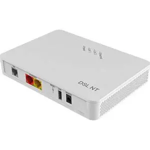

# ZTE H186 Home Assistant Integration (HACS)

<p align="center">
  
</p>

[](https://github.com/hacs/default)
[](https://github.com/Ebenhoeh80/zte-h186/releases)
[](LICENSE)
[](https://developers.home-assistant.io/docs/core/integration-quality-scale/)
[](#internationalisierung-i18n)
[](https://www.paypal.com/pool/9p84qTHCFr?sr=wccr)

[English](README.md) | [Deutsch](README.de.md) | [Français](README.fr.md) | [Español](README.es.md)

Eine native, asynchrone Home Assistant Custom Integration für das **ZTE H186 DSL-Modem**. Liest DSL-Leitungstelemetrie (Sync-Raten, Störabstandsmargen SNR, Leitungsdämpfung, CRC/FEC-Fehlerzähler, Übertragungsprofil und Showtime-Laufzeit) in Echtzeit direkt aus der lokalen Weboberfläche des Modems aus.

---

## 🚀 Funktionen

- **UI-Einrichtung (Config Flow)**: Schnelle Einrichtung direkt in der Home Assistant Benutzeroberfläche (*Einstellungen > Geräte & Dienste > Integration hinzufügen*). Kein YAML erforderlich.
- **Neukonfigurations-Flow**: Komfortables Ändern von Modem-IP, Hostname oder Passwort ohne Verlust von Entitäts-IDs, Dashboards oder Langzeitstatistiken.
- **Optionen-Flow**: Anpassbares Abfrageintervall von 15 bis 600 Sekunden (Standard: 60 Sekunden).
- **Session-Caching & Effizienz**: Hält die authentifizierte Sitzung aktiv und fängt Timeouts automatisch ab.
- **Volle 4-Sprachen-Unterstützung (i18n)**: Automatische Lokalisierung in Englisch, Deutsch, Französisch und Spanisch.
- **27 Sensoren**:
  - **Bandbreite & Synchronisation**: Downstream & Upstream Sync-Rate (Mbit/s), erreichbare Kapazität (Mbit/s), Leitungsauslastung (%).
  - **Signalqualität**: Downstream & Upstream Störabstandsmarge (SNR in dB), Leitungsdämpfung (dB), Sendeleistung (dBm).
  - **Framing & Latenz**: DSL-Profil (z. B. 17a, 35b), Modulationsstandard (VDSL2), Datenpfad (Fast/Interleaved), Interleave-Tiefe & Verzögerung, Impulsschutz (INP).
  - **Laufzeit & Fehler**: Showtime-Dauer, unkorrigierte CRC-Fehler, korrigierte FEC-Bitfehler.
- **Binärsensoren**:
  - `dsl_link`: Physikalischer DSL-Verbindungsstatus.
  - `line_noise_warning`: Warnanzeige bei kritischem SNR-Abfall unter 6,0 dB.
- **Aktionsbutton**:
  - `refresh_stats`: Sofortiges manuelles Abfragen der Modemwerte.
- **Diagnose-Export**: Bereinigte Diagnose-Dumps mit maskierten Passwörtern per Klick.

---

## 📦 Installation via HACS

### Methode 1: HACS Custom Repository (Empfohlen)

1. **Home Assistant** öffnen.
2. Zu **HACS** > **Integrationen** navigieren.
3. Auf das Drei-Punkte-Menü (⋮) oben rechts klicken und **Benutzerdefinierte Repositories** wählen.
4. Repository-URL eintragen:
   ```text
   https://github.com/Ebenhoeh80/zte-h186
   ```
5. Typ **Integration** wählen und auf **Hinzufügen** klicken.
6. **ZTE H186 DSL Modem** auswählen und auf **Herunterladen** klicken.
7. Home Assistant neu starten.

### Methode 2: Manuelle Installation

1. Das Release-Archiv `zte-h186-v1.4.0.zip` herunterladen.
2. Den Ordner `custom_components/zte_h186` in dein Home-Assistant-Verzeichnis kopieren:
   ```text
   /config/custom_components/zte_h186
   ```
3. Home Assistant neu starten.

---

## ⚙️ Konfiguration

1. In Home Assistant zu **Einstellungen** > **Geräte & Dienste** navigieren.
2. Unten rechts auf **Integration hinzufügen** klicken.
3. Nach **ZTE H186 DSL Modem** suchen.
4. Verbindungsdaten eingeben:
   - **IP-Adresse oder Hostname**: `<MODEM-LAN-IP>` (feste Verwaltungs-IP des Modems)
   - **Benutzername**: `admin`
   - **Passwort**: Passwort der Modem-Weboberfläche
5. Auf **Absenden** klicken.

> 💡 **Hardware-Verkabelung & Netzwerk**: Für eine umfassende Anleitung zur physischen Port-Verkabelung (Rot WAN, Gelb LAN, Grau DSL), Deaktivierung des integrierten DHCP-Servers und Zuweisung einer statischen IP siehe die [Verkabelungs- und Managementanleitung](docs/de/HomeAssistant.md#verkabelung-und-lokale-verwaltung-des-modems).

---

## 🌐 Internationalisierung (i18n)

Die Integration unterstützt nativ 4 Sprachen:
- 🇬🇧 **Englisch (`en`)** – Kanonische Quellsprache
- 🇩🇪 **Deutsch (`de`)** – Vollständige deutsche Übersetzung
- 🇫🇷 **Französisch (`fr`)** – Traduction technique complète
- 🇪🇸 **Spanisch (`es`)** – Localización técnica en español

Die Übersetzungen gelten automatisch für:
- Einrichtungs- und Neukonfigurationsdialoge
- Options-Dialoge
- Fehler- und Abbruchmeldungen
- Alle 27 Sensornamen und Beschreibungen

---

## 🗺️ Roadmap & Ideen

Geplant und in Prüfung — **gib dem ein 👍, was dir wichtig ist**, und bring eigene Ideen ein:

- 🔜 Diagnose ohne die Modem-Adresse in Fehlermeldungen
- 💡 Statische Typprüfung (mypy) in der CI
- 💡 Reparatur-Hinweis, wenn das Modem nicht erreichbar ist

➡️ Alle Ideen & Abstimmung: **[Discussions → Ideas](https://github.com/Ebenhoeh80/zte-h186/discussions/categories/ideas)**

---

## 📄 Lizenz

Dieses Projekt ist unter der MIT-Lizenz lizenziert – siehe [LICENSE](LICENSE).  
Copyright (C) 2026 Daniel Ebenhöh.

---

## ❤️ Projekt unterstützen

<div align="center">

**Ich entwickle und pflege diese Integration in meiner Freizeit und trage die laufenden Kosten – meine Zeit, Strom sowie die Entwicklungswerkzeuge und IT-Ausstattung, die ich dafür nutze – aus eigener Tasche.**

Wenn sie dir Zeit oder Ärger erspart, hilft eine kleine freiwillige Spende, das Projekt am Laufen zu halten. Jeder Beitrag, egal wie klein, freut mich riesig. Vielen Dank! 🙏

<a href="https://www.paypal.com/pool/9p84qTHCFr?sr=wccr">
  
</a>
<a href="https://buymeacoffee.com/daneben">
  
</a>

</div>
