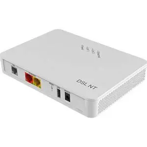

# Integración de ZTE H186 para Home Assistant (HACS)

<p align="center">
  
</p>

[](https://github.com/hacs/default)
[](https://github.com/Ebenhoeh80/zte-h186/releases)
[](LICENSE)
[](https://developers.home-assistant.io/docs/core/integration-quality-scale/)
[](#internacionalización-i18n)
[](https://www.paypal.com/pool/9p84qTHCFr?sr=wccr)

[English](README.md) | [Deutsch](README.de.md) | [Français](README.fr.md) | [Español](README.es.md)

Una integración personalizada asíncrona para el **módem DSL ZTE H186**. Lee telemetría de línea DSL en tiempo real (velocidades de sincronización, margen SNR, atenuación, contadores de errores CRC/FEC, perfil de transmisión y tiempo de actividad Showtime) directamente desde la interfaz web local del módem.

---

## 🚀 Características

- **Configuración mediante interfaz de usuario (Config Flow)**: Configuración rápida directamente desde la interfaz de Home Assistant (*Ajustes > Dispositivos y servicios > Añadir integración*). No requiere YAML.
- **Flujo de Reconfiguración**: Actualice la dirección IP, el nombre de host o la contraseña sin perder ID de entidades, paneles o historial.
- **Flujo de Opciones**: Intervalo de sondeo configurable de 15 a 600 segundos (predeterminado: 60 segundos).
- **Caché de sesión y eficiencia**: Mantiene activa la sesión autenticada y se recupera automáticamente tras expiraciones.
- **Soporte completo de 4 idiomas (i18n)**: Inglés, alemán, francés y español.
- **27 sensores completos**:
  - **Ancho de banda y sincronización**: Velocidad de sincronización de bajada y subida (Mbit/s), capacidad máxima alcanzable (Mbit/s), utilización de línea (%).
  - **Calidad de señal**: Margen de ruido (SNR en dB), atenuación de línea (dB), potencia de transmisión (dBm).
  - **Tramas y latencia**: Perfil DSL (ej. 17a, 35b), estándar de modulación (VDSL2), ruta de datos (Fast/Interleaved), profundidad y retardo de entrelazado, protección contra ruido impulsivo (INP).
  - **Tiempo de actividad y errores**: Duración de sincronización Showtime, errores CRC no corregidos, errores de bit FEC corregidos.
- **Sensores binarios**:
  - `dsl_link`: Estado de la conexión física DSL.
  - `line_noise_warning`: Alerta de ruido cuando el margen SNR cae por debajo de 6,0 dB.
- **Botón de acción**:
  - `refresh_stats`: Desencadena un sondeo inmediato de estadísticas.

---

## 📦 Instalación mediante HACS

1. Abra **Home Assistant**.
2. Vaya a **HACS** > **Integraciones**.
3. Haga clic en el menú de tres puntos (⋮) en la esquina superior derecha y seleccione **Repositorios personalizados**.
4. Ingrese la URL:
   ```text
   https://github.com/Ebenhoeh80/zte-h186
   ```
5. Seleccione la categoría **Integración** y haga clic en **Añadir**.
6. Descargue **ZTE H186 DSL Modem** y reinicie Home Assistant.

---

## ⚙️ Configuración

1. En Home Assistant, vaya a **Ajustes** > **Dispositivos y servicios**.
2. Haga clic en **Añadir integración** y busque **ZTE H186 DSL Modem**.
3. Introduzca la dirección IP (`<MODEM-LAN-IP>`), el usuario (`admin`) y la contraseña.
4. Envíe el formulario.

> 💡 **Cableado de hardware**: Consulte la [Guía de cableado y administración local](docs/es/HomeAssistant.md#cableado-de-hardware-y-administración-local-del-módem).

### Opciones

En el diálogo **Configurar** de la integración puede cambiar:

- **Intervalo de actualización (segundos)**: cada cuánto se consulta el módem, de 15 a 600 segundos (predeterminado: 60).
- **Liberar la sesión del módem después de cada actualización** (predeterminado: desactivado): el módem solo permite una sesión de administrador. Con esta opción activada, Home Assistant cierra la sesión en el módem después de cada actualización para que pueda abrir su interfaz web en cualquier momento. Cuesta unas seis solicitudes por actualización en lugar de una, así que use un intervalo de actualización de 120 segundos o más.

---

## 🗺️ Hoja de ruta e ideas

Planificado y en estudio — **dale un 👍 a lo que te importe** y aporta tus propias ideas:

- 🔜 Diagnóstico sin la dirección del módem en los mensajes de error
- 💡 Comprobación estática de tipos (mypy) en la CI
- 💡 Aviso de reparación cuando el módem no es accesible

➡️ Todas las ideas y votación: **[Discussions → Ideas](https://github.com/Ebenhoeh80/zte-h186/discussions/categories/ideas)**

---

## 📄 Licencia

Este proyecto está bajo la Licencia MIT – consulte [LICENSE](LICENSE).  
Copyright (C) 2026 Daniel Ebenhöh.

---

## ❤️ Apoya el proyecto

<div align="center">

**Desarrollo y mantengo esta integración en mi tiempo libre y asumo los costes de funcionamiento — mi tiempo, la electricidad y las herramientas de desarrollo y el equipamiento informático que utilizo — de mi propio bolsillo.**

Si te ahorra tiempo o problemas, una pequeña propina voluntaria ayuda a mantener el proyecto en marcha. Cada aportación, por pequeña que sea, se agradece enormemente. ¡Gracias! 🙏

<a href="https://www.paypal.com/pool/9p84qTHCFr?sr=wccr">
  
</a>
<a href="https://buymeacoffee.com/daneben">
  
</a>

</div>
