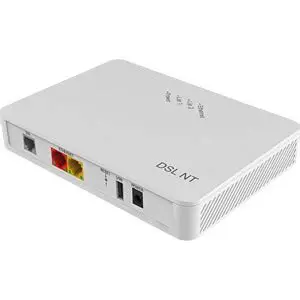

# Intégration Home Assistant ZTE H186 (HACS)

<p align="center">
  
</p>

[](https://github.com/hacs/default)
[](https://github.com/Ebenhoeh80/zte-h186/releases)
[](LICENSE)
[](https://developers.home-assistant.io/docs/core/integration-quality-scale/)
[](#internationalisation-i18n)
[](https://www.paypal.com/pool/9p84qTHCFr?sr=wccr)

[English](README.md) | [Deutsch](README.de.md) | [Français](README.fr.md) | [Español](README.es.md)

Une intégration personnalisée asynchrone pour le **modem DSL ZTE H186**. Lit la télémétrie de ligne DSL en temps réel (débits de synchronisation, marge SNR, atténuation, compteurs d'erreurs CRC/FEC, profil et temps de fonctionnement Showtime) directement depuis l'interface web locale du modem.

---

## 🚀 Fonctionnalités

- **Configuration via l'interface UI (Config Flow)** : Configuration rapide directement dans l'interface utilisateur de Home Assistant (*Paramètres > Appareils et services > Ajouter une intégration*). Aucun YAML requis.
- **Flux de Reconfiguration** : Modifiez l'adresse IP, le nom d'hôte ou le mot de passe sans perdre vos identifiants d'entité, historiques ou tableaux de bord.
- **Flux d'Options** : Intervalle de scrutation configurable de 15 à 600 secondes (par défaut : 60 secondes).
- **Mise en cache de session & Efficacité** : Maintient la session active et gère automatiquement les expirations de session.
- **Prise en charge intégrale des 4 langues (i18n)** : Localisation en anglais, allemand, français et espagnol.
- **27 capteurs complets** :
  - **Bande passante et synchronisation** : Débit de synchronisation montant et descendant (Mbit/s), capacité maximale (Mbit/s), utilisation de la ligne (%).
  - **Qualité du signal** : Marge de bruit (SNR en dB), atténuation de ligne (dB), puissance de transmission (dBm).
  - **Trames & Latence** : Profil DSL (ex. 17a, 35b), standard de modulation (VDSL2), chemin de données (Fast/Interleaved), profondeur et délai d'entrelacement, protection contre le bruit impulsionnel (INP).
  - **Temps de fonctionnement & Erreurs** : Durée de synchronisation Showtime, erreurs CRC non corrigées, erreurs binaires FEC corrigées.
- **Capteurs binaires** :
  - `dsl_link` : État de la liaison physique DSL.
  - `line_noise_warning` : Alerte si la marge de bruit descend en dessous de 6,0 dB.
- **Bouton d'action** :
  - `refresh_stats` : Déclenche une mise à jour immédiate des statistiques.

---

## 📦 Installation via HACS

1. Ouvrez **Home Assistant**.
2. Allez dans **HACS** > **Intégrations**.
3. Cliquez sur le menu à trois points (⋮) en haut à droite et choisissez **Dépôts personnalisés**.
4. Saisissez l'URL :
   ```text
   https://github.com/Ebenhoeh80/zte-h186
   ```
5. Sélectionnez le type **Intégration** et cliquez sur **Ajouter**.
6. Téléchargez **ZTE H186 DSL Modem** et redémarrez Home Assistant.

---

## ⚙️ Configuration

1. Dans Home Assistant, allez dans **Paramètres** > **Appareils et services**.
2. Cliquez sur **Ajouter une intégration** et recherchez **ZTE H186 DSL Modem**.
3. Renseignez l'adresse IP (`<MODEM-LAN-IP>`), le nom d'utilisateur (`admin`) et le mot de passe.
4. Validez.

> 💡 **Câblage physique** : Consultez le [Guide de câblage et de gestion locale](docs/fr/HomeAssistant.md#câblage-et-gestion-locale-du-modem).

### Options

Dans la boîte de dialogue **Configurer** de l'intégration, vous pouvez modifier :

- **Intervalle d'actualisation (secondes)** : fréquence d'interrogation du modem, de 15 à 600 secondes (par défaut : 60).
- **Libérer la session du modem après chaque mise à jour** (par défaut : désactivé) : le modem n'autorise qu'une seule session d'administration. Lorsque cette option est activée, Home Assistant se déconnecte du modem après chaque mise à jour, afin que vous puissiez ouvrir à tout moment son interface web. Cela représente environ six requêtes par mise à jour au lieu d'une ; utilisez donc un intervalle d'actualisation de 120 secondes ou plus.

---

## 🗺️ Feuille de route et idées

Prévu et à l'étude — **mettez un 👍 sur ce qui compte pour vous** et proposez vos idées :

- 💡 Notification de réparation lorsque le modem est injoignable

➡️ Toutes les idées et le vote: **[Discussions → Ideas](https://github.com/Ebenhoeh80/zte-h186/discussions/categories/ideas)**

---

## 📄 Licence

Ce projet est sous licence MIT – voir [LICENSE](LICENSE).  
Copyright (C) 2026 Daniel Ebenhöh.

---

## ❤️ Soutenir le projet

<div align="center">

**Je développe et maintiens cette intégration sur mon temps libre et je prends en charge les frais de fonctionnement — mon temps, l'électricité ainsi que les outils de développement et le matériel informatique que j'utilise — de ma poche.**

Si elle vous fait gagner du temps ou vous évite des soucis, un petit don volontaire aide à faire vivre le projet. Chaque contribution, même modeste, est très appréciée. Merci ! 🙏

Le parrainage est volontaire et ne donne droit à aucun support, fonctionnalité ni délai de réponse.

<a href="https://github.com/sponsors/Ebenhoeh80">
  
</a>
<a href="https://www.paypal.com/pool/9p84qTHCFr?sr=wccr">
  
</a>
<a href="https://buymeacoffee.com/daneben">
  
</a>

</div>
