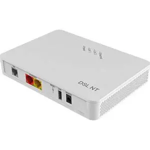

# ZTE H186 Home Assistant Integration (HACS)

<p align="center">
  
</p>

[](https://github.com/hacs/default)
[](https://github.com/Ebenhoeh80/zte-h186/releases)
[](LICENSE)
[](https://developers.home-assistant.io/docs/core/integration-quality-scale/)
[](#internationalization-i18n)

An asynchronous Home Assistant custom integration for the **ZTE H186 DSL Modem**. Reads real-time DSL line telemetry (sync rates, SNR margins, line attenuation, CRC/FEC error counters, transmission profile, and showtime uptime) directly from the modem's local web interface.

---

## 🚀 Features

- **UI-Based Setup (Config Flow)**: Fast configuration directly through the Home Assistant user interface (*Settings > Devices & Services > Add Integration*). No YAML required.
- **Reconfigure Flow**: Seamlessly update modem IP address, hostname, or admin password without losing entity IDs, dashboards, or long-term history.
- **Options Flow**: Customizable polling interval from 15 to 600 seconds (default: 60 seconds).
- **Session Caching & Efficiency**: Keeps the authenticated session active and automatically recovers from session timeouts, preventing unnecessary load on the modem.
- **Full Internationalization (i18n)**: Automatically renders in English, German, French, or Spanish based on your Home Assistant profile language.
- **27 Comprehensive Sensors**:
  - **Bandwidth & Sync**: Downstream & Upstream Sync Rate (Mbit/s), Maximum Attainable Capacity (Mbit/s), Line Capacity Utilization (%).
  - **Signal Integrity**: Downstream & Upstream Signal-to-Noise Ratio (SNR Margin in dB), Line Attenuation (dB), Output Transmit Power (dBm).
  - **Line Framing & Latency**: DSL Profile (e.g., 17a, 35b Supervectoring), Modulation Standard (VDSL2), Data Path Mode (Interleaved/Fast), Interleave Depth & Delay (ms), Impulse Noise Protection (INP in symbols).
  - **Uptime & Errors**: Link Showtime duration, Downstream & Upstream uncorrectable CRC errors, Downstream & Upstream corrected FEC bit errors.
- **Binary Sensors**:
  - `dsl_link`: Physical DSL link connectivity status.
  - `line_noise_warning`: Problem indicator triggered when SNR margin drops below 6.0 dB.
- **Action Button**:
  - `refresh_stats`: Trigger an immediate modem poll manually or from automations.
- **Full Diagnostics**: Export sanitized diagnostic logs (passwords automatically redacted) with one click from the device page.

---

## 📦 Installation via HACS

### Method 1: HACS Custom Repository (Recommended)

1. Open **Home Assistant**.
2. Navigate to **HACS** > **Integrations**.
3. Click the three-dot menu (⋮) in the top-right corner and select **Custom repositories**.
4. Enter the repository URL:
   ```text
   https://github.com/Ebenhoeh80/zte-h186
   ```
5. Select Type: **Integration** and click **Add**.
6. Find **ZTE H186 DSL Modem** and click **Download**.
7. Restart Home Assistant.

### Method 2: Manual Installation

1. Download the latest `zte-h186-v1.0.0.zip` release archive.
2. Copy the folder `custom_components/zte_h186` into your Home Assistant directory under:
   ```text
   /config/custom_components/zte_h186
   ```
3. Restart Home Assistant.

---

## ⚙️ Configuration

1. In Home Assistant, go to **Settings** > **Devices & Services**.
2. Click **Add Integration** in the bottom-right corner.
3. Search for **ZTE H186 DSL Modem**.
4. Provide your connection details:
   - **IP Address or Hostname**: `<MODEM-LAN-IP>` (your modem's local management IP)
   - **Username**: `admin` (default)
   - **Password**: Your modem's web administration password
5. Click **Submit**. Home Assistant will validate the connection and automatically create the device and all entities.

> 💡 **Hardware Wiring & Setup**: For a comprehensive guide on physical port cabling (Red WAN, Yellow LAN, Grey DSL), disabling the modem's internal DHCP server, and assigning a static management IP, see the [Cabling & Local Management Guide](docs/HomeAssistant.md#verkabelung-und-lokale-verwaltung-des-modems).

---

## 📊 Entity Directory

| Entity ID Pattern | Type | Unit | Description |
|---|---|---|---|
| `sensor.zte_h186_<ip>_downstream_sync` | Sensor | Mbit/s | Current downstream sync rate |
| `sensor.zte_h186_<ip>_upstream_sync` | Sensor | Mbit/s | Current upstream sync rate |
| `sensor.zte_h186_<ip>_downstream_max` | Sensor | Mbit/s | Maximum attainable downstream rate |
| `sensor.zte_h186_<ip>_upstream_max` | Sensor | Mbit/s | Maximum attainable upstream rate |
| `sensor.zte_h186_<ip>_downstream_capacity_ratio` | Sensor (Diag) | % | Downstream sync / capacity ratio |
| `sensor.zte_h186_<ip>_downstream_snr` | Sensor | dB | Downstream SNR noise margin |
| `sensor.zte_h186_<ip>_upstream_snr` | Sensor | dB | Upstream SNR noise margin |
| `sensor.zte_h186_<ip>_downstream_attenuation` | Sensor | dB | Downstream line attenuation |
| `sensor.zte_h186_<ip>_upstream_attenuation` | Sensor | dB | Upstream line attenuation |
| `sensor.zte_h186_<ip>_downstream_power` | Sensor (Diag) | dBm | Downstream transmit power |
| `sensor.zte_h186_<ip>_upstream_power` | Sensor (Diag) | dBm | Upstream transmit power |
| `sensor.zte_h186_<ip>_profile` | Sensor | - | DSL carrier profile (e.g., 17a, 35b) |
| `sensor.zte_h186_<ip>_modulation` | Sensor | - | Modulation standard (e.g., VDSL2) |
| `sensor.zte_h186_<ip>_dsl_status` | Sensor | - | DSL link status (e.g., Up) |
| `sensor.zte_h186_<ip>_showtime` | Sensor (Diag) | s | Continuous Showtime uptime |
| `sensor.zte_h186_<ip>_downstream_crc` | Sensor (Diag) | errors | Uncorrected downstream CRC errors |
| `sensor.zte_h186_<ip>_upstream_crc` | Sensor (Diag) | errors | Uncorrected upstream CRC errors |
| `sensor.zte_h186_<ip>_downstream_fec` | Sensor (Diag) | errors | Corrected downstream FEC errors |
| `sensor.zte_h186_<ip>_upstream_fec` | Sensor (Diag) | errors | Corrected upstream FEC errors |
| `binary_sensor.zte_h186_<ip>_dsl_link` | Binary Sensor | - | Active physical link connectivity |
| `binary_sensor.zte_h186_<ip>_line_noise_warning` | Binary Sensor | - | Warning triggered when SNR < 6.0 dB |
| `button.zte_h186_<ip>_refresh_stats` | Button | - | Immediate telemetry poll trigger |

*Note: Technical framing metrics (`interleave_depth`, `interleave_delay`, `inp`, `data_path`, `link_encapsulation`) are organized under the Diagnostic entity category to maintain a clean default dashboard.*

---

## 🌐 Internationalization (i18n)

The integration natively supports 4 languages:
- 🇬🇧 **English (`en`)** – Canonical source language
- 🇩🇪 **German (`de`)** – Technisch präzise Lokalisierung
- 🇫🇷 **French (`fr`)** – Traduction technique complète
- 🇪🇸 **Spanish (`es`)** – Localización técnica en español

Translations automatically apply to:
- Config flow & reconfigure dialogs
- Options flow dialogs
- Error and abort messages
- All 27 sensor names and descriptions
- Diagnostic attributes

To contribute additional translations, please see [CONTRIBUTING.md](CONTRIBUTING.md).

---

## 🔒 Security & Architecture

- **Token Challenge Handshake**: Implements the authentic 5-step ZTE handshake: JavaScript `_sessionTmpToken` hex-decode, numeric challenge token retrieval, `SHA-256(password + challenge)` POST, `SID` session cookie retention, and session priming.
- **Credential Protection**: Passwords are never logged in plain text. Diagnostics downloads automatically redact all credential fields.
- **Runtime Data**: Follows modern Home Assistant architecture using `entry.runtime_data = coordinator`.

---

## 📄 License

This project is licensed under the GNU General Public License v3.0 – see [LICENSE](LICENSE).  
Copyright (C) 2026 Daniel Ebenhöh.