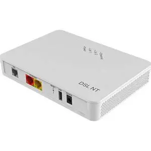

# ZTE H186 Home Assistant Integration (HACS)

<p align="center">
  
</p>

[](https://github.com/hacs/default)
[](https://github.com/Ebenhoeh80/zte-h186/releases)
[](LICENSE)
[](https://developers.home-assistant.io/docs/core/integration-quality-scale/)
[](#internationalization-i18n)
[](https://www.paypal.com/pool/9p84qTHCFr?sr=wccr)
[](https://buymeacoffee.com/daneben)

[English](README.md) | [Deutsch](README.de.md) | [Français](README.fr.md) | [Español](README.es.md)

An asynchronous Home Assistant custom integration for the **ZTE H186 DSL Modem**. Reads real-time DSL line telemetry (sync rates, SNR margins, line attenuation, CRC/FEC error counters, transmission profile, and showtime uptime) directly from the modem's local web interface.

---

## 🚀 Features

- **UI-Based Setup (Config Flow)**: Fast configuration directly through the Home Assistant user interface (*Settings > Devices & Services > Add Integration*). No YAML required.
- **Reconfigure Flow**: Seamlessly update modem IP address, hostname, or admin password without losing entity IDs, dashboards, or long-term history.
- **Options Flow**: Customizable polling interval from 15 to 600 seconds (default: 60 seconds).
- **Session Caching & Efficiency**: Keeps the authenticated session active and automatically recovers from session timeouts, preventing unnecessary load on the modem.
- **Full Internationalization (i18n)**: Automatically renders in English, German, French, or Spanish based on your Home Assistant profile language.
- **27 Comprehensive Sensors**:
  - **Bandwidth & Sync**: Downstream & Upstream Sync Rate (Mbit/s), Maximum Attainable Capacity (Mbit/s), Line Capacity Utilization (%).
  - **Signal Integrity**: Downstream & Upstream Signal-to-Noise Ratio (SNR Margin in dB), Line Attenuation (dB), Output Transmit Power (dBm).
  - **Line Framing & Latency**: DSL Profile (e.g., 17a, 35b Supervectoring), Modulation Standard (VDSL2), Data Path Mode (Interleaved/Fast), Interleave Depth & Delay (ms), Impulse Noise Protection (INP in symbols).
  - **Uptime & Errors**: Link Showtime duration, Downstream & Upstream uncorrectable CRC errors, Downstream & Upstream corrected FEC bit errors.
- **Binary Sensors**:
  - `dsl_link`: Physical DSL link connectivity status.
  - `line_noise_warning`: Problem indicator triggered when SNR margin drops below 6.0 dB.
- **Action Button**:
  - `refresh_stats`: Trigger an immediate modem poll manually or from automations.
- **Full Diagnostics**: Export sanitized diagnostic logs (passwords automatically redacted) with one click from the device page.

---

## 📦 Installation via HACS

### Method 1: HACS Custom Repository (Recommended)

1. Open **Home Assistant**.
2. Navigate to **HACS** > **Integrations**.
3. Click the three-dot menu (⋮) in the top-right corner and select **Custom repositories**.
4. Enter the repository URL:
   ```text
   https://github.com/Ebenhoeh80/zte-h186
   ```
5. Select Type: **Integration** and click **Add**.
6. Find **ZTE H186 DSL Modem** and click **Download**.
7. Restart Home Assistant.

### Method 2: Manual Installation

1. Download the latest `zte-h186-v1.4.0.zip` release archive.
2. Copy the folder `custom_components/zte_h186` into your Home Assistant directory under:
   ```text
   /config/custom_components/zte_h186
   ```
3. Restart Home Assistant.

---

## ⚙️ Configuration

1. In Home Assistant, go to **Settings** > **Devices & Services**.
2. Click **Add Integration** in the bottom-right corner.
3. Search for **ZTE H186 DSL Modem**.
4. Provide your connection details:
   - **IP Address or Hostname**: `<MODEM-LAN-IP>` (your modem's local management IP)
   - **Username**: `admin` (default)
   - **Password**: Your modem's web administration password
5. Click **Submit**. Home Assistant will validate the connection and automatically create the device and all entities.

> 💡 **Hardware Wiring & Setup**: For a comprehensive guide on physical port cabling (Red WAN, Yellow LAN, Grey DSL), disabling the modem's internal DHCP server, and assigning a static management IP, see the [Cabling & Local Management Guide](docs/HomeAssistant.md#verkabelung-und-lokale-verwaltung-des-modems).

---

## 📊 Entity Directory

| Entity ID Pattern | Type | Unit | Description |
|---|---|---|---|
| `sensor.zte_h186_downstream_sync` | Sensor | Mbit/s | Current downstream sync rate |
| `sensor.zte_h186_upstream_sync` | Sensor | Mbit/s | Current upstream sync rate |
| `sensor.zte_h186_downstream_max` | Sensor | Mbit/s | Maximum attainable downstream rate |
| `sensor.zte_h186_upstream_max` | Sensor | Mbit/s | Maximum attainable upstream rate |
| `sensor.zte_h186_downstream_capacity_ratio` | Sensor (Diag) | % | Downstream sync / capacity ratio |
| `sensor.zte_h186_downstream_snr` | Sensor | dB | Downstream SNR noise margin |
| `sensor.zte_h186_upstream_snr` | Sensor | dB | Upstream SNR noise margin |
| `sensor.zte_h186_downstream_attenuation` | Sensor | dB | Downstream line attenuation |
| `sensor.zte_h186_upstream_attenuation` | Sensor | dB | Upstream line attenuation |
| `sensor.zte_h186_downstream_power` | Sensor (Diag) | dBm | Downstream transmit power |
| `sensor.zte_h186_upstream_power` | Sensor (Diag) | dBm | Upstream transmit power |
| `sensor.zte_h186_profile` | Sensor | - | DSL carrier profile (e.g., 17a, 35b) |
| `sensor.zte_h186_modulation` | Sensor | - | Modulation standard (e.g., VDSL2) |
| `sensor.zte_h186_dsl_status` | Sensor (Enum) | - | DSL link status: `connected`, `disconnected`, `initializing`, `idle`, `no_signal`, `disabled` (localized) |
| `sensor.zte_h186_showtime` | Sensor (Diag) | s | Continuous Showtime uptime |
| `sensor.zte_h186_downstream_crc` | Sensor (Diag) | errors | Uncorrected downstream CRC errors |
| `sensor.zte_h186_upstream_crc` | Sensor (Diag) | errors | Uncorrected upstream CRC errors |
| `sensor.zte_h186_downstream_fec` | Sensor (Diag) | errors | Corrected downstream FEC errors |
| `sensor.zte_h186_upstream_fec` | Sensor (Diag) | errors | Corrected upstream FEC errors |
| `binary_sensor.zte_h186_dsl_link` | Binary Sensor | - | Active physical link connectivity |
| `binary_sensor.zte_h186_line_noise_warning` | Binary Sensor | - | Warning triggered when SNR < 6.0 dB |
| `button.zte_h186_refresh_stats` | Button | - | Immediate telemetry poll trigger |

*Note: Technical framing metrics (`interleave_depth`, `interleave_delay`, `inp`, `data_path`, `link_encapsulation`) are organized under the Diagnostic entity category to maintain a clean default dashboard.*

---

## 🖥️ Supported Devices

This integration is developed and verified against the **ZTE H186A** VDSL2/ADSL2+ DSL modem (the model exposed by the German ISP 1&1 / GENEXIS variants that ship the same ZTE web firmware). It talks to the modem's **local web interface only** — no cloud account is involved.

It is likely to work on other ZTE DSL modems that use the same `getpage.lua` / `internet_dsl_interface_lua.lua` firmware endpoints and the `_sessionTmpToken` + `SHA-256(password + challenge)` login handshake. If you confirm another model, please open an issue so it can be listed.

## 🔧 Supported Functions

- **Read-only DSL line telemetry** — the integration only *reads* line statistics; it never changes modem configuration.
- 27 sensors, 2 binary sensors and 1 action button (see the [Entity Directory](#-entity-directory)).
- Reconfigure flow (change host/credentials), options flow (polling interval), re-authentication flow, and downloadable diagnostics.

## 🔄 Data Updates

The integration uses **local polling**. A `DataUpdateCoordinator` fetches all line statistics in a single authenticated request on a fixed interval (default **60 s**, configurable 15–600 s via the options flow). The authenticated session is cached and automatically re-established after a modem-side session timeout, so each poll is a single lightweight request. The **Refresh DSL Stats Now** button triggers an immediate poll on demand.

If a poll fails, entities become `unavailable` and the failure is logged once; an authentication failure starts the Home Assistant re-authentication flow instead of retrying endlessly.

## 💡 Use Cases & Automation Examples

**Notify when the DSL line drops:**
```yaml
automation:
  - alias: "DSL line lost"
    triggers:
      - trigger: state
        entity_id: binary_sensor.zte_h186_dsl_link
        to: "off"
        for: "00:01:00"
    actions:
      - action: notify.mobile_app_phone
        data:
          title: "DSL line down"
          message: "The DSL line has been disconnected for over a minute."
```

**Warn on degrading line quality (low SNR margin):**
```yaml
automation:
  - alias: "DSL noise warning"
    triggers:
      - trigger: state
        entity_id: binary_sensor.zte_h186_line_noise_warning
        to: "on"
    actions:
      - action: notify.mobile_app_phone
        data:
          message: >
            SNR margin dropped below 6 dB (down {{ states('sensor.zte_h186_downstream_snr') }} dB).
```

Long-term `sync rate`, `SNR margin` and `CRC/FEC error` sensors also feed nicely into history/statistics cards for spotting slow line degradation over weeks.

## ⚠️ Known Limitations

- **One modem per config entry.** The H186 web firmware allows only a single admin web session, so running a second client (e.g. a browser logged into the modem) at the same time can invalidate the integration's session until the next poll re-authenticates.
- **Login lockout.** The firmware temporarily locks the admin account after repeated failed logins (`DisplayLockTime`). Avoid rapid credential changes.
- **Fields only populate in Showtime.** While the line is down or training, the modem omits most metrics; those sensors report `unknown` until the line is back up.
- **Read-only.** Modem settings cannot be changed through this integration by design.

## 🩺 Troubleshooting

| Symptom | Likely cause / fix |
|---|---|
| Setup fails with *"Invalid username or password"* | Verify the admin password in the modem's web UI. Note the lockout after repeated failures — wait a few minutes. |
| Setup fails with *"Failed to connect"* | Check the management IP/hostname and that Home Assistant can reach the modem's LAN interface. |
| Entities show `unavailable` | A poll failed (modem rebooting, session conflict, network blip). It recovers on the next successful poll; check **Settings → System → Logs**. |
| Integration asks you to re-authenticate | The stored credentials were rejected — enter the current password in the re-auth dialog. |

For a bug report, download **Diagnostics** from the device page (credentials are redacted automatically) and attach it to a [GitHub issue](https://github.com/Ebenhoeh80/zte-h186/issues).

## 🗑️ Removal

Remove the integration from **Settings → Devices & Services → ZTE H186 DSL Modem → ⋮ → Delete**. This deletes the config entry, its device and all entities. To remove the code as well, delete it from **HACS** (or remove `custom_components/zte_h186` for a manual install) and restart Home Assistant.

---

## 🌐 Internationalization (i18n)

The integration natively supports 4 languages:
- 🇬🇧 **English (`en`)** – Canonical source language
- 🇩🇪 **German (`de`)** – Technisch präzise Lokalisierung
- 🇫🇷 **French (`fr`)** – Traduction technique complète
- 🇪🇸 **Spanish (`es`)** – Localización técnica en español

Translations automatically apply to:
- Config flow & reconfigure dialogs
- Options flow dialogs
- Error and abort messages
- All 27 sensor names and descriptions
- Diagnostic attributes

To contribute additional translations, please see [CONTRIBUTING.md](CONTRIBUTING.md).

---

## 🔒 Security & Architecture

- **Token Challenge Handshake**: Implements the authentic 5-step ZTE handshake: JavaScript `_sessionTmpToken` hex-decode, numeric challenge token retrieval, `SHA-256(password + challenge)` POST, `SID` session cookie retention, and session priming.
- **Credential Protection**: Passwords are never logged in plain text. Diagnostics downloads automatically redact all credential fields.
- **Runtime Data**: Follows modern Home Assistant architecture using `entry.runtime_data = coordinator`.

---

## 🗺️ Roadmap & ideas

Planned and under consideration — **give a 👍 to what matters to you**, and bring your own ideas:

- 🔜 Diagnostics without the modem address in error messages
- 💡 Static type checking (mypy) in CI
- 💡 Repair notice when the modem is unreachable

➡️ All ideas & voting: **[Discussions → Ideas](https://github.com/Ebenhoeh80/zte-h186/discussions/categories/ideas)**

---

## 📄 License

This project is licensed under the MIT License – see [LICENSE](LICENSE).  
Copyright (C) 2026 Daniel Ebenhöh.

---

## ❤️ Support this project

<div align="center">

**I build and maintain this integration in my free time, and cover the running costs — my time, electricity, and the development tools and IT equipment I use — out of my own pocket.**

If it saves you time or trouble, a small voluntary tip helps keep the project going. Every contribution, however small, is hugely appreciated. Thank you! 🙏

<a href="https://www.paypal.com/pool/9p84qTHCFr?sr=wccr">
  
</a>
<a href="https://buymeacoffee.com/daneben">
  
</a>

</div>
